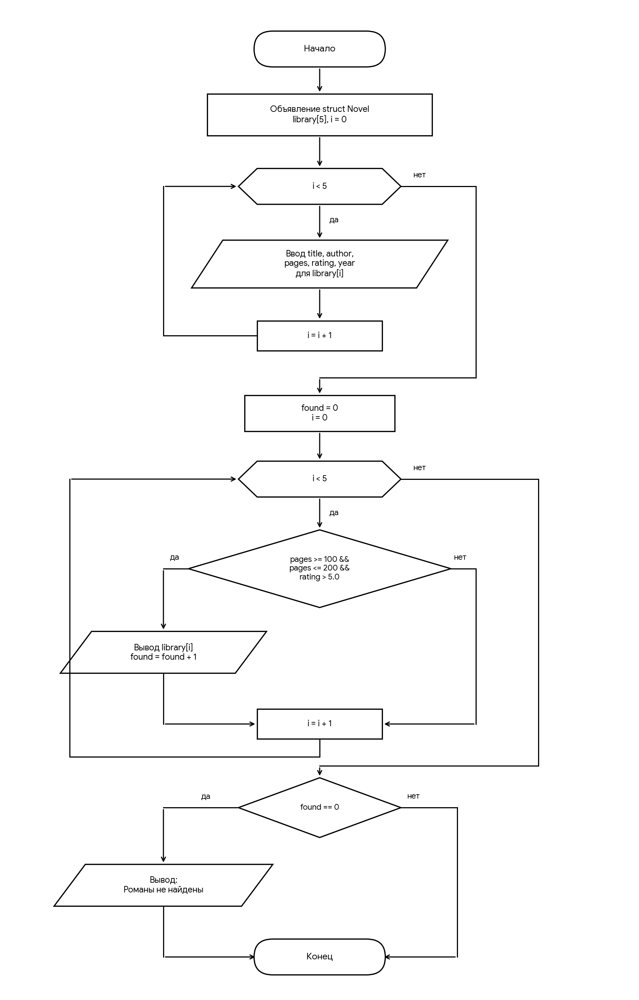

# Домашнее задание к работе 18

## Условие задачи

Создать структуру для хранения указанной в индивидуальном варианте записи (**Вариант 26**: Запись «Современный роман»), организовать в программе ввод 5–10 различных записей, из полученного массива структур найти и напечатать информацию согласно индивидуальному варианту:
- **Поля структуры:** Название, Автор, Кол-во страниц, Средняя оценка по отзывам (от 0 до 10 баллов), Год издания.
- **Условие поиска:** Вывести данные о романах, с количеством страниц от 100 до 200 и оценкой больше 5.

## 1. Алгоритм и блок-схема
### Алгоритм решения
1. **Начало**.
2. Объявить структуру `Novel` с полями: `title` (название), `author` (автор), `pages` (количество страниц), `rating` (средняя оценка), `year` (год издания).
3. Создать массив структур `library` размером `MAX_BOOKS` (5 элементов) и инициализировать счетчик найденных книг `found = 0`.
4. В цикле от `i = 0` до `MAX_BOOKS - 1` ввести данные для каждого романа с клавиатуры (название, автор, количество страниц, оценка, год издания) и очистить буфер ввода.
5. В цикле от `i = 0` до `MAX_BOOKS - 1` проверить условие для текущего элемента: `pages >= 100 && pages <= 200 && rating > 5.0`.
   - Если условие истинно: вызвать функцию `print_book(&library[i])` для вывода информации о романе и увеличить `found` на 1.
6. После завершения цикла проверить значение `found`:
   - Если `found == 0`: вывести сообщение о том, что подходящие романы не найдены.
7. **Конец**.

### Блок-схема


## 2. Реализация программы

```c
#define _CRT_SECURE_NO_WARNINGS
#include <stdio.h>
#include <string.h>
#include <locale.h>

#define MAX_BOOKS 5

struct Novel {
    char title[100];  
    char author[100]; 
    int pages;        
    float rating;     
    int year;         
};

void print_book(const struct Novel* b) {
    printf("«%s» — %s (%d г.), страниц: %d, оценка: %.1f/10\n",
        b->title, b->author, b->year, b->pages, b->rating);
}

int main() {
    setlocale(LC_ALL, "rus");

    struct Novel library[MAX_BOOKS];
    int ch;

    // 1. Организация ввода массива структур
    for (int i = 0; i < MAX_BOOKS; i++) {
        printf("=== Ввод данных о романе №%d ===\n", i + 1);

        printf("Название: ");
        fgets(library[i].title, sizeof(library[i].title), stdin);
        library[i].title[strcspn(library[i].title, "\n")] = 0; // Удаление символа переноса строки

        printf("Автор: ");
        fgets(library[i].author, sizeof(library[i].author), stdin);
        library[i].author[strcspn(library[i].author, "\n")] = 0;

        printf("Количество страниц: ");
        scanf("%d", &library[i].pages);

        printf("Средняя оценка (от 0.0 до 10.0): ");
        scanf("%f", &library[i].rating);

        printf("Год издания: ");
        scanf("%d", &library[i].year);

        // Очищаем буфер от остаточного '\n' после scanf перед следующим fgets
        while ((ch = getchar()) != '\n' && ch != EOF);
        printf("\n");
    }

    printf("--- Результаты фильтрации (Страниц: 100-200, Оценка > 5) ---\n");
    int found = 0;

    for (int i = 0; i < MAX_BOOKS; i++) {
        // Условие: кол-во страниц от 100 до 200 И оценка больше 5
        if (library[i].pages >= 100 && library[i].pages <= 200 && library[i].rating > 5.0) {
            print_book(&library[i]);
            found++;
        }
    }

    if (found == 0) {
        printf("Романы, соответствующие заданным критериям, не найдены.\n");
    }

    return 0;
}
```

## 3. Результаты работы программы

```text
=== Ввод данных о романе №1 ===
Название: Старик и море
Автор: Эрнест Хемингуэй
Количество страниц: 128
Средняя оценка (от 0.0 до 10.0): 8.5
Год издания: 1952

=== Ввод данных о романе №2 ===
Название: Скотный двор
Автор: Джордж Оруэлл
Количество страниц: 112
Средняя оценка (от 0.0 до 10.0): 8.7
Год издания: 1945

=== Ввод данных о романе №3 ===
Название: Война и мир
Автор: Лев Толстой
Количество страниц: 1300
Средняя оценка (от 0.0 до 10.0): 9.2
Год издания: 1869

=== Ввод данных о романе №4 ===
Название: Маленький принц
Автор: Антуан де Сент-Экзюпери
Количество страниц: 96
Средняя оценка (от 0.0 до 10.0): 9.0
Год издания: 1943

=== Ввод данных о романе №5 ===
Название: Черновик
Автор: Иван Иванов
Количество страниц: 150
Средняя оценка (от 0.0 до 10.0): 4.2
Год издания: 2023

--- Результаты фильтрации (Страниц: 100-200, Оценка > 5) ---
«Старик и море» — Эрнест Хемингуэй (1952 г.), страниц: 128, оценка: 8.5/10
«Скотный двор» — Джордж Оруэлл (1945 г.), страниц: 112, оценка: 8.7/10
```

## 4. Информация о разработчике
**Сёмкин Сергей Алексеевич БИЦТ 262**
